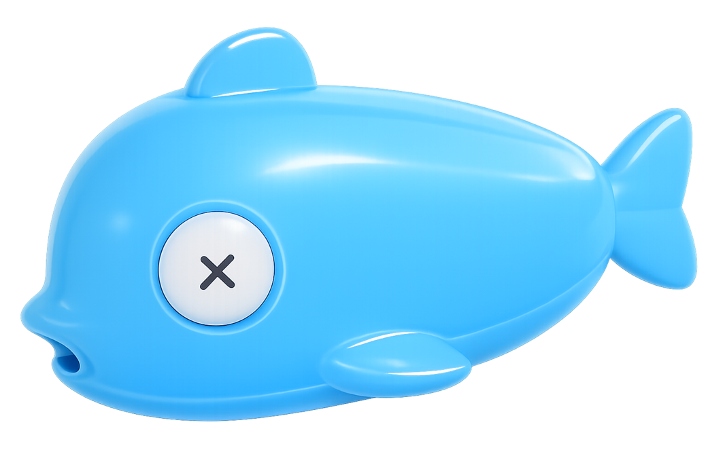
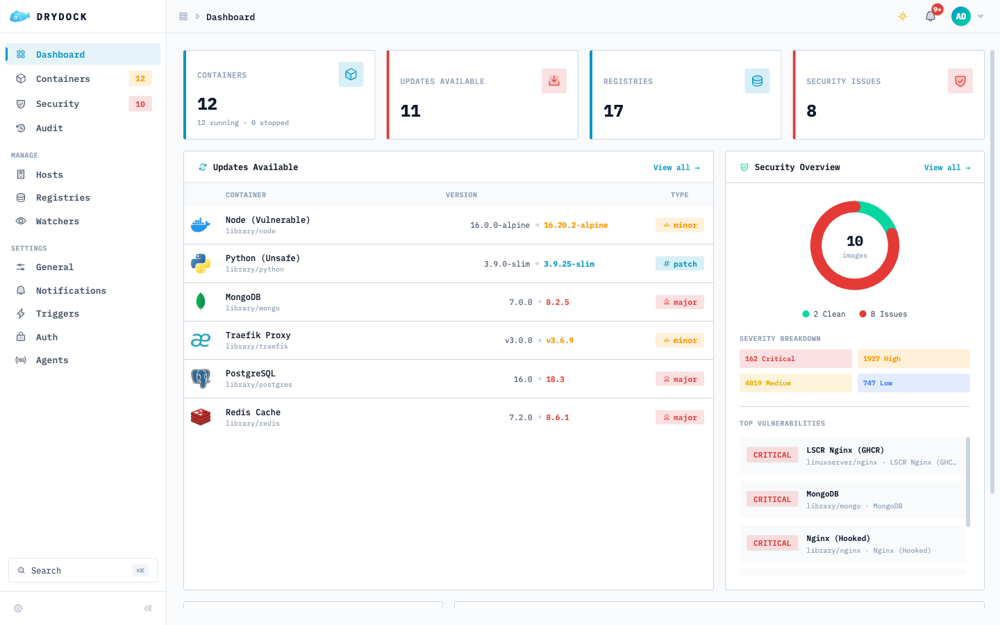
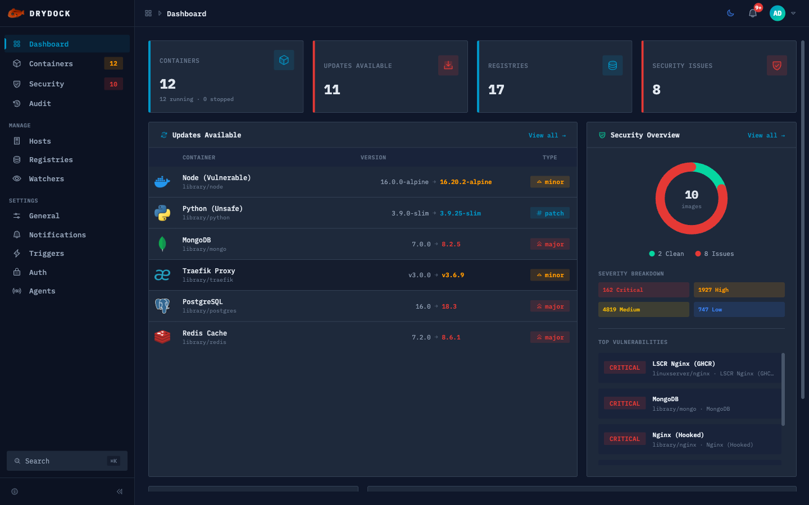
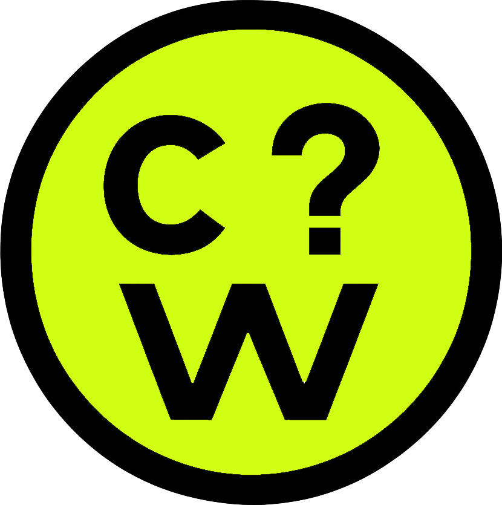

<div align="center">

<p><a href="README.md">English</a> · <a href="README.es.md">Español</a> · <a href="README.pl.md">Polski</a> · <a href="README.zh-CN.md">简体中文</a> · <a href="README.de.md">Deutsch</a> · <a href="README.fr.md">Français</a> · <a href="README.pt-BR.md">Português (Brasil)</a> · <strong>Türkçe</strong></p>

<picture>
  <source media="(prefers-color-scheme: dark)" srcset="docs/assets/whale-logo-dark.png" />
  <source media="(prefers-color-scheme: light)" srcset="docs/assets/whale-logo.png" />
  
</picture>

<h1>drydock</h1>

**Konteyner imaj güncelleme izleyicisi — 23 kayıt defteri, 21 bildirim ve eylem sağlayıcısı.**

</div>

<p align="center">
  <a href="https://github.com/CodesWhat/drydock/releases"></a>
  <a href="https://github.com/orgs/CodesWhat/packages/container/package/drydock"></a>
  <a href="LICENSE"></a>
  <br>
  <a href="https://github.com/CodesWhat/drydock/actions/workflows/ci-verify.yml"></a>
  <a href="https://securityscorecards.dev/viewer/?uri=github.com/CodesWhat/drydock"></a>
  <a href="https://www.bestpractices.dev/projects/11915"></a>
  <a href="https://qlty.sh/gh/CodesWhat/projects/drydock"></a>
  <a href="https://dashboard.stryker-mutator.io/reports/github.com/CodesWhat/drydock/main"></a>
  <a href="https://codecov.io/gh/CodesWhat/drydock"></a>
  <br>
  <a href="https://hub.docker.com/r/codeswhat/drydock"></a>
  <a href="https://github.com/CodesWhat/drydock/stargazers"></a>
  <a href="https://github.com/veggiemonk/awesome-docker#container-management"></a>
  <a href="https://crowdin.com/project/drydock"></a>
  <a href="https://github.com/sponsors/CodesWhat"></a>
</p>

<hr>

> [!WARNING]
> **v1.8.0-rc.17 isteğe bağlı bir test derlemesidir.** Denemeden önce Drydock'u durdurun ve tüm store dizinini yedekleyin. İlk başlatma JSON verilerini SQLite'a aktarır. Sürüm düşürmek, yükseltme öncesi anlık görüntünün geri yüklenmesini gerektirir; yalnızca SQLite'ta yapılan değişiklikler geri taşınmaz. Bkz. [geçiş ve kullanımdan kaldırmalar](DEPRECATIONS.md).

<!-- separate release and upgrade alerts -->

> [!WARNING]
> **1.5.x veya daha eski bir sürümden mi güncelliyorsunuz?** Daha fazla güvenlik sıkılaştırma düzeltmesi ek süre tanınmadan uygulanır. Hiçbir kimlik doğrulama yapılandırılmamış veya anonim kimlik doğrulama etkinleştirilmiş ancak onaylanmamış bir örnek, yükseltme sonrasında tıpkı temiz bir kurulum gibi artık **fail-closed (kapalı hata)** modunda çalışır: konteyner çalışır; korumalı API istekleri `401` döndürür; kimlik doğrulama keşif/durum rotaları herkese açık kalır ve `/health` `503` döndürür. SPA kabuğu yüklenmeye devam edebilir ancak korumalı uygulama verilerini okuyamaz. Yükseltmeden önce `DD_ANONYMOUS_AUTH_CONFIRM=true` ayarlayın veya `DD_AUTH_BASIC_*`/OIDC yapılandırın. Oturum çerezi `connect.sid` → `drydock.sid` olarak yeniden adlandırılmıştır, bu nedenle mevcut tüm kullanıcıların oturumu bir kez kapatılır. HTTP bildirim tetikleyicileri (artı Hass webhook ve kayıt defteri simge getirmeleri) artık bulut meta veri/bağlantı-yerel hedeflerini engelleyen korumalı bir DNS araması üzerinden ana bilgisayar adlarını çözer ve yönlendirmeleri asla izlemez — gerçekten ihtiyacınız varsa belirli bir `DD_NOTIFICATION_HTTP_*` tetikleyicisinde `allowmetadata=true` ayarlayın. Tam geçiş rehberi için **[DEPRECATIONS.md](DEPRECATIONS.md#enforced-security-changes-no-deprecation-window)** belgesine bakın.

**Kararlı bakım sürümü: [v1.7.1](https://github.com/CodesWhat/drydock/releases/tag/v1.7.1).** Konteyner yeniden oluşturma düzeltmelerini, ortam gizli bilgilerinin sansürlenmesini ve çalışma zamanı güvenlik güncellemelerini içerir. `codeswhat/drydock:1.7.1` sürümünü sabitleyin, deponuzu yedekleyin ve geleneksel ajanları denetleyici ile birlikte yükseltin. GA sürümü rc.7'yi yeniden kullanır ve `1.7.1-rc.7` derleme kimliğini korur. [Kararlı sürüm yükseltme notlarına](https://getdrydock.com/docs/v1.7/updates) bakın.

<h2 align="center">İçindekiler</h2>

- [Belgeler](#documentation)
- [Hızlı Başlangıç](#quick-start)
- [Ekran Görüntüleri ve Canlı Demo](#screenshots)
- [Neden Drydock](#why-drydock)
- [Özellikler](#features)
- [Desteklenen Entegrasyonlar](#supported-integrations)
- [Özellik Karşılaştırması](#feature-comparison)
- [Geçiş](#migration)
- [Yol Haritası](#roadmap)
- [Star History](#star-history)
- [Kullanılan Teknolojiler](#built-with)
- [Topluluk ve Destek](#community-support)
- [CodesWhat Ekosistemi](#codeswhat-ecosystem)

<hr>

<h2 align="center" id="documentation">Belgeler</h2>

| Kaynak | Bağlantı |
| --- | --- |
| Web Sitesi | [getdrydock.com](https://getdrydock.com/) |
| Canlı Demo | [demo.getdrydock.com](https://demo.getdrydock.com) |
| Belgeler | [getdrydock.com/docs](https://getdrydock.com/docs) |
| Yapılandırma | [Yapılandırma](https://getdrydock.com/docs/configuration) |
| Hızlı Başlangıç | [Hızlı Başlangıç](https://getdrydock.com/docs/quickstart) |
| Değişiklik Günlüğü | [`CHANGELOG.md`](CHANGELOG.md) |
| Kullanımdan Kaldırmalar | [`DEPRECATIONS.md`](DEPRECATIONS.md) |
| Yol Haritası | Aşağıdaki [Yol Haritası](#roadmap) bölümüne bakın |
| Katkıda Bulunma | [`CONTRIBUTING.md`](CONTRIBUTING.md) |
| Davranış Kuralları | [`CODE_OF_CONDUCT.md`](CODE_OF_CONDUCT.md) |
| Yönetişim | [`GOVERNANCE.md`](GOVERNANCE.md) |
| Güvenlik Güvencesi | [`SECURITY-ASSURANCE.md`](SECURITY-ASSURANCE.md) |
| Güvenlik Politikası | [`SECURITY.md`](SECURITY.md) |
| Sorunlar | [GitHub Issues](https://github.com/CodesWhat/drydock/issues) |
| Tartışmalar | [GitHub Discussions](https://github.com/CodesWhat/drydock/discussions) — özellik istekleri ve fikirler memnuniyetle karşılanır |

<hr>

<h2 align="center" id="quick-start">Hızlı Başlangıç</h2>

**Önerilen: Drydock'un erişebileceği Docker API uç noktalarını kısıtlamak için bir soket vekili (socket proxy) kullanın.** Bu, konteynere Docker soketine tam erişim vermekten kaçınır.

> **Not:** Compose, `$` işaretini değişken enterpolasyonu sözdizimi olarak ele alır; bu nedenle tek `$` ile yapıştırılan bir argon2id karma değeri Drydock'a bozulmuş olarak ulaşır. Gerçek karma değerini yapıştırırken her `$` işaretini `$$` olarak çiftleyin, örneğin `$$argon2id$$v=19$$m=65536,t=3,p=4$$salt$$hash`.

```yaml
services:
  drydock:
    image: codeswhat/drydock
    depends_on:
      socket-proxy:
        condition: service_healthy
    volumes:
      - drydock-store:/store
    environment:
      - DD_WATCHER_LOCAL_HOST=socket-proxy
      - DD_WATCHER_LOCAL_PORT=2375
      - DD_AUTH_BASIC_ADMIN_USER=admin
      - "DD_AUTH_BASIC_ADMIN_HASH=<paste-argon2id-hash>"
    ports:
      - 3000:3000

  socket-proxy:
    image: tecnativa/docker-socket-proxy
    volumes:
      - /var/run/docker.sock:/var/run/docker.sock
    environment:
      - CONTAINERS=1
      - IMAGES=1
      - EVENTS=1
      - SERVICES=1
      - INFO=1          # Daemon kimliği algılama için gereklidir (bildirim önekleri)
      # Konteyner eylemleri ve otomatik güncellemeler için POST=1 ve NETWORKS=1 ekleyin
    healthcheck:
      test: wget --spider http://localhost:2375/version || exit 1
      interval: 5s
      timeout: 3s
      retries: 3
      start_period: 5s
    restart: unless-stopped

volumes:
  drydock-store:
```

<details>
<summary>Alternatif: <a href="https://github.com/CodesWhat/sockguard">sockguard</a> soket vekili</summary>

[sockguard](https://github.com/CodesWhat/sockguard), aynı CodesWhat ekosisteminden drydock için oluşturulmuş bir ön ayara sahip varsayılan-ret (default-deny) Docker soket filtresidir:

> **Not:** Compose, `$` işaretini değişken enterpolasyonu sözdizimi olarak ele alır; bu nedenle tek `$` ile yapıştırılan bir argon2id karma değeri Drydock'a bozulmuş olarak ulaşır. Gerçek karma değerini yapıştırırken her `$` işaretini `$$` olarak çiftleyin, örneğin `$$argon2id$$v=19$$m=65536,t=3,p=4$$salt$$hash`.

```yaml
services:
  drydock:
    image: codeswhat/drydock
    depends_on:
      sockguard:
        condition: service_healthy
    volumes:
      - drydock-store:/store
    environment:
      - DD_WATCHER_LOCAL_HOST=sockguard
      - DD_WATCHER_LOCAL_PORT=2375
      - DD_AUTH_BASIC_ADMIN_USER=admin
      - "DD_AUTH_BASIC_ADMIN_HASH=<paste-argon2id-hash>"
    ports:
      - 3000:3000

  sockguard:
    image: codeswhat/sockguard
    volumes:
      - /var/run/docker.sock:/var/run/docker.sock
      - ./sockguard.yaml:/etc/sockguard/config.yaml:ro
    environment:
      - SOCKGUARD_CONFIG_FILE=/etc/sockguard/config.yaml
    healthcheck:
      test: wget --spider http://localhost:2375/version || exit 1
      interval: 5s
      timeout: 3s
      retries: 3
      start_period: 5s
    restart: unless-stopped

volumes:
  drydock-store:
```

Başlangıç `sockguard.yaml` dosyası için sockguard'ın [`app/configs/drydock.yaml`](https://github.com/CodesWhat/sockguard/blob/main/app/configs/drydock.yaml) ön ayarına bakın.

</details>

<details>
<summary>Alternatif: doğrudan soket bağlama ile hızlı başlangıç</summary>

```bash
docker run -d \
  --name drydock \
  -p 3000:3000 \
  -v /var/run/docker.sock:/var/run/docker.sock \
  -v drydock-store:/store \
  -e DD_AUTH_BASIC_ADMIN_USER=admin \
  -e 'DD_AUTH_BASIC_ADMIN_HASH=<paste-argon2id-hash>' \
  codeswhat/drydock:latest
```

> **Uyarı:** Doğrudan soket erişimi konteynere Docker daemon üzerinde tam kontrol sağlar. Üretim dağıtımları için yukarıdaki soket vekili kurulumunu kullanın. Uzak TLS ve köksüz (rootless) Docker dahil tüm seçenekler için [Docker Soket Güvenliği rehberine](https://getdrydock.com/docs/configuration/watchers#docker-socket-security) bakın.
>
> Gösterildiği gibi karma değerinin etrafında tek tırnak kullanın. Çift tırnak, docker görmeden önce kabuğun `$` işaretini genişletmesine izin vererek gerçek bir argon2id karma değerini bozar.

</details>

> Bir parola karması oluşturun (`argon2` CLI — paket yöneticiniz aracılığıyla kurun):
>
> ```bash
> echo -n "yourpassword" | argon2 $(openssl rand -base64 32) -id -m 16 -t 3 -p 4 -l 64 -e
> ```
>
> Veya Node.js 24.7+ ile (ek paket gerekmez):
>
> ```bash
> node -e 'const c=require("node:crypto");const s=c.randomBytes(32);const h=c.argon2Sync("argon2id",{message:process.argv[1],nonce:s,memory:65536,passes:3,parallelism:4,tagLength:64});console.log("argon2id$65536$3$4$"+s.toString("base64")+"$"+h.toString("base64"));' "yourpassword"
> ```
>
> Drydock v1.6 yalnızca argon2id Temel (Basic) kimlik doğrulama karmalarını kabul eder. Eski `{SHA}`, `$apr1$`/`$1$`, `crypt` ve düz metin karmalar reddedilir; yükseltmeden önce bunları yeniden oluşturun.
> Kimlik doğrulama **varsayılan olarak zorunludur**. OIDC, anonim erişim ve diğer seçenekler için [kimlik doğrulama belgelerine](https://getdrydock.com/docs/configuration/authentications) bakın.
> Anonim erişim, hem yeni hem de yükseltilmiş örneklerde `DD_ANONYMOUS_AUTH_CONFIRM=true` ile açıkça onaylanmalıdır. Bu olmadan, kimlik doğrulama yapılandırılmamış (veya onaylanmamış anonim kimlik doğrulamaya sahip) bir örnek fail-closed olarak başlar: korumalı API istekleri `401` döndürür, herkese açık kimlik doğrulama keşif/durum rotaları erişilebilir kalır ve `/health` `503` döndürür.

İmajda herhangi bir tarayıcı ikili dosyası bulunmaz. `DD_SECURITY_SCANNER=grype` ayarlayın; Drydock, Grype, Syft ve cosign'ı sabitlenmiş işçi konteynerlerinden çalıştırır.

Docker Compose, soket güvenliği, ters vekil ve alternatif kayıt defterleri için [Hızlı Başlangıç rehberine](https://getdrydock.com/docs/quickstart) bakın.

Her sürümde nelerin değiştiği [`CHANGELOG.md`](CHANGELOG.md) dosyasında ve [GitHub Releases](https://github.com/CodesWhat/drydock/releases) sayfasında yer alır.

<hr>

<h2 align="center" id="screenshots">Ekran Görüntüleri ve Canlı Demo</h2>

<p align="center">
  
</p>

<p align="center"><em>Bir güncellemeyi fark edin, tam olarak neyin değiştiğini görün, uygulayın. Yedekleme, sağlık kontrolü ve geri alma otomatik halledilir.</em></p>

<table>
<tr>
<td width="50%" align="center"><strong>Açık</strong></td>
<td width="50%" align="center"><strong>Koyu</strong></td>
</tr>
<tr>
<td></td>
<td></td>
</tr>
</table>

<div align="center">

**Kendiniz deneyimleyebilecekken neden ekran görüntülerine bakasınız?**

<a href="https://demo.getdrydock.com"></a>

Tamamen etkileşimli — gerçek arayüz, örnek veriler, kurulum gerektirmez. Tamamen tarayıcıda çalışır.

</div>

<hr>

<h2 align="center" id="why-drydock">Neden Drydock</h2>

Konteyner imajları sessizce güncelliğini yitirir. Bir temel imaj bir CVE'yi yamalar, bir uygulama yeni sürüm çıkarır, bir etiket değişir. Her kayıt defterini elle izlemediğiniz sürece, çalışan konteynerleriniz bir şeyler bozulana veya istismar edilene kadar geride kalır.

Çoğu araç bir ödün vermeye zorlar. Otomatik güncelleyiciler (Watchtower, Ouroboros) çok az görünürlük veya kontrolle çeker ve yeniden başlatır ve artık büyük ölçüde bakımsızdır. Panolar (Portainer) konteynerleri yönetir ancak güncelleme zekası için tasarlanmamıştır. Drydock **önce izleme (monitor-first)** odaklıdır: 23 kayıt defterini izler ve herhangi bir şey olmadan önce tam olarak neyin değiştiğini (major, minor, patch veya digest) size bildirir, ardından yalnızca siz izin verdiğinizde harekete geçer. Ve bunların hepsinden daha ileri gider: Trivy/Grype güvenlik açığı taraması güvenli olmayan güncellemeleri engeller, cosign imzaları doğrular, güncelleme öncesi imaj yedekleri sağlık kontrolü başarısızlığında otomatik olarak geri alır, dağıtık ajanlar uzak ana bilgisayarları kapsar ve 21 bildirim ve eylem entegrasyonu döngüyü tamamlar. Web arayüzü ve REST API ile eksiksiz güncelleme yaşam döngüsü.

<hr>

<h2 align="center" id="features">Özellikler</h2>

| | Özellik | Açıklama |
|---|---|---|
| 🔭 | **Önce İzleme Algılaması** | Çalışan her konteyneri izler ve mevcut her güncellemeyi herhangi bir şey olmadan önce major, minor, patch veya digest olarak sınıflandırır. Siz onaylayana kadar hiçbir şey değişmez. |
| 📦 | **23 Kayıt Defteri Sağlayıcısı** | Docker Hub, GHCR, ECR, ACR, GCR, GAR, GitLab, Quay, Harbor, Artifactory, Nexus ve 12 tane daha. Kayıt defteri başına TLS ve kimlik doğrulama ile genel ve özel, bulut ve kendi barındırdığınız. |
| 🔔 | **21 Tetikleyici** | Olay/sağlayıcı başına şablonlar, canlı önizleme, eşik filtreleme ve toplu mod ile 17 bildirim kanalı (Slack, Discord, Telegram, Teams, SMTP, MQTT, ntfy ve daha fazlası) artı Docker, Docker Compose, Portainer ve Command eylemleri. |
| 🥊 | **Güncelleme Fedaisi (Update Bouncer)** | Trivy/Grype güvenlik açığı taraması, cosign imza doğrulama ve SBOM oluşturma (CycloneDX ve SPDX) ile güvenli olmayan güncellemeleri dağıtılmadan önce engeller. |
| ↩️ | **İmaj Yedekleme ve Otomatik Geri Alma** | Yapılandırılabilir saklama süresiyle güncelleme öncesi imaj anlık görüntüleri, sağlık kontrolü başarısızlığında otomatik geri alma ve arayüzden tek tıkla manuel geri alma. |
| 🪝 | **Yaşam Döngüsü Kancaları** | Kanca başına zaman aşımları ve hata durumunda iptal kontrolü ile konteyner etiketleri aracılığıyla güncelleme öncesi ve sonrası kabuk komutları. |
| 🗂️ | **Docker Compose Güncellemeleri** | YAML'ı koruyan imaj yamasıyla Docker Engine API üzerinden Compose hizmetlerini çekin ve yeniden oluşturun. |
| 🎛️ | **Konteyner Başına Politika** | Regex etiket kuralları ve tetikleyici yönlendirmesi `dd.*` etiketlerini kullanır; olgunluk ve atlama kuralları `dd.updatePolicy.*` etiketleriyle ayarlanabilir; erteleme, sabitleme ve bakım pencereleri arayüz/API veya izleyici yapılandırması aracılığıyla saklanır. Kalıcı grup politikaları, bir grubun mevcut ve gelecekteki her üyesi için güncelleme politikası varsayılanlarını ve yalnızca kısıtlayıcı eylem kurallarını belirler. |
| 🛰️ | **Dağıtık Ajanlar** | Uzak Docker ana bilgisayarlarını SSE üzerinden izleyin. Portwing 0.9.0+ ajanları gelen Standart HTTP veya giden Edge WebSocket aktarımı üzerinden çalışır; Drydock 1.6.0-rc.11+, her iki kimliği doğrulanmış yol üzerinden denetleyici tarafında yerel kayıt defteri kontrolleri ve tekli/toplu Docker güncellemeleri çalıştırabilir. Edge ayrıca gelen port gerektirmeden kesintisiz canlı günlükler taşır; `DD_EXPERIMENTAL_PORTWING=false` acil durum devre dışı bırakma seçeneği olarak kalır. |
| 🖥️ | **Web Kontrol Paneli** | Sıfır bağımlılıklı özelleştirilebilir widget ızgarası, duyarlı tablo/kart görünümleri, canlı SSE güncellemeleri, bildirim zili kontrolleri ve konteyner başına ayrıntılar, günlükler ve istatistikler sunan Vue 3 arayüzü. |
| 🔗 | **REST API ve Webhook'lar** | CI/CD izleme ve güncelleme tetikleyicileri için belirteç doğrulamalı uç noktalar ve push olayları için imzalı kayıt defteri webhook alımı. |
| 🔐 | **OIDC Kimlik Doğrulama** | Kontrol panelini OpenID Connect (Authelia, Auth0, Authentik) ile güvenceye alın. Tüm kimlik doğrulama akışları varsayılan olarak fail-closed çalışır. |
| 📈 | **Prometheus Metrikleri** | Prometheus ve Grafana izleme yığınları için isteğe bağlı kimlik doğrulama atlamalı yerleşik `/metrics` uç noktası. |
| 🌍 | **17 Arayüz Dili** | İngilizce eksiksiz ve Crowdin üzerinden senkronize edilen 16 topluluk destekli yerel ayarla tam kablolanmış çeviri sistemi, Ayarlar'dan değiştirilebilir. |
| 🔒 | **ReDoS'a Dayanıklı Regex** | Kullanıcı tarafından sağlanan her etiket deseni, yıkıcı geri izleme (catastrophic backtracking) deseni tarafından durdurulamayan doğrusal zamanlı eşleştirme için re2js (saf JS RE2 portu) üzerinden derlenir. |

<hr>

<h2 align="center" id="supported-integrations">Desteklenen Entegrasyonlar</h2>

### Kayıt Defterleri (23)

Docker Hub · GHCR · ECR · ACR · GCR · GAR · GitLab · Quay · LSCR · Harbor · Artifactory · Nexus · Gitea · Forgejo · Codeberg · MAU · TrueForge · Custom · DOCR · DHI · IBM Cloud · Oracle Cloud · Alibaba Cloud

### Eylemler (4)

Docker · Docker Compose · Portainer · Command

### Bildirimler (17)

Apprise · Discord · Google Chat · Gotify · HTTP · IFTTT · Kafka · Matrix · Mattermost · MQTT · MS Teams · NTFY · Pushover · Rocket.Chat · Slack · SMTP · Telegram

### Kimlik Doğrulama

Anonim (`DD_ANONYMOUS_AUTH_CONFIRM=true` ile isteğe bağlı) · Basic (kullanıcı adı + parola karması) · OIDC (Authelia, Auth0, Authentik). Tüm kimlik doğrulama akışları varsayılan olarak fail-closed çalışır.

### Güncelleme Fedaisi (Update Bouncer)

Trivy veya Grype destekli güvenlik açığı taraması, güvenli olmayan güncellemeleri dağıtılmadan önce engeller. Cosign imza doğrulama ve SBOM oluşturma (CycloneDX ve SPDX) içerir.

<hr>

<h2 align="center" id="feature-comparison">Özellik Karşılaştırması</h2>

<details>
<summary><strong>drydock diğer konteyner güncelleme araçlarıyla nasıl karşılaştırılır?</strong></summary>

> ✅ = destekleniyor &nbsp; ❌ = desteklenmiyor &nbsp; ⚠️ = kısmi / sınırlı &nbsp; ? = doğrulanmamış &nbsp; † = arşivlenmiş, artık bakımı yapılmıyor

<h4 align="center">Güncelleme yöneticileri</h4>

<table>
<thead>
<tr>
<th width="32%">Özellik</th>
<th width="17%" align="center">drydock</th>
<th width="17%" align="center">WUD</th>
<th width="17%" align="center">Diun</th>
<th width="17%" align="center"><em>Watchtower&nbsp;†</em></th>
</tr>
</thead>
<tbody>
<tr><td>Aktif olarak bakımı yapılıyor</td><td align="center">✅</td><td align="center">✅</td><td align="center">✅</td><td align="center">❌</td></tr>
<tr><td>Web Arayüzü / Kontrol Paneli</td><td align="center">✅</td><td align="center">✅</td><td align="center">❌</td><td align="center">❌</td></tr>
<tr><td>Konteynerleri otomatik güncelleme</td><td align="center">✅</td><td align="center">✅</td><td align="center">❌</td><td align="center">✅</td></tr>
<tr><td>Docker Compose güncellemeleri</td><td align="center">✅</td><td align="center">✅</td><td align="center">❌</td><td align="center">⚠️</td></tr>
<tr><td>Semver duyarlı güncellemeler</td><td align="center">✅</td><td align="center">✅</td><td align="center">⚠️</td><td align="center">❌</td></tr>
<tr><td>Digest izleme</td><td align="center">✅</td><td align="center">✅</td><td align="center">✅</td><td align="center">✅</td></tr>
<tr><td>Güncelleme eşiği filtreleme (major/minor/patch/digest)</td><td align="center">✅</td><td align="center">✅</td><td align="center">❌</td><td align="center">❌</td></tr>
<tr><td>Bağımlılık duyarlı güncelleme sıralaması</td><td align="center">⚠️</td><td align="center">❌</td><td align="center">❌</td><td align="center">❌</td></tr>
<tr><td>Swarm / Kubernetes / Nomad izleyicileri</td><td align="center">❌</td><td align="center">⚠️</td><td align="center">✅</td><td align="center">❌</td></tr>
<tr><td>Onay bekleyen kuyruk (v1.8 RC)</td><td align="center">✅</td><td align="center">❌</td><td align="center">❌</td><td align="center">❌</td></tr>
<tr><td>İmaj yedekleme ve geri alma</td><td align="center">✅</td><td align="center">⚠️</td><td align="center">❌</td><td align="center">❌</td></tr>
<tr><td>Yaşam döngüsü kancaları (önce/sonra)</td><td align="center">✅</td><td align="center">✅</td><td align="center">❌</td><td align="center">✅</td></tr>
<tr><td>Güvenlik açığı taraması</td><td align="center">✅</td><td align="center">❌</td><td align="center">❌</td><td align="center">❌</td></tr>
<tr><td>Denetim günlüğü</td><td align="center">✅</td><td align="center">❌</td><td align="center">❌</td><td align="center">❌</td></tr>
<tr><td>RBAC / çoklu kullanıcı rolleri</td><td align="center">❌</td><td align="center">✅</td><td align="center">❌</td><td align="center">❌</td></tr>
<tr><td>OIDC / SSO kimlik doğrulama</td><td align="center">✅</td><td align="center">✅</td><td align="center">❌</td><td align="center">❌</td></tr>
<tr><td>Tetikleyici / bildirim kanalları</td><td align="center">21</td><td align="center">33</td><td align="center">17</td><td align="center">~20</td></tr>
<tr><td>MQTT / Home Assistant</td><td align="center">✅</td><td align="center">✅</td><td align="center">⚠️</td><td align="center">❌</td></tr>
<tr><td>Kayıt defteri sağlayıcıları</td><td align="center">23</td><td align="center">25</td><td align="center">⚠️</td><td align="center">⚠️</td></tr>
<tr><td>REST API</td><td align="center">✅</td><td align="center">✅</td><td align="center">⚠️</td><td align="center">⚠️</td></tr>
<tr><td>CI/CD için Webhook API</td><td align="center">✅</td><td align="center">⚠️</td><td align="center">❌</td><td align="center">✅</td></tr>
<tr><td>Kapsamlı API belirteçleri / anahtarları</td><td align="center">✅</td><td align="center">✅</td><td align="center">❌</td><td align="center">❌</td></tr>
<tr><td>Tek seferlik mod (bir kez çalıştır, sonra çık)</td><td align="center">❌</td><td align="center">✅</td><td align="center">✅</td><td align="center">✅</td></tr>
<tr><td>Prometheus metrikleri</td><td align="center">✅</td><td align="center">✅</td><td align="center">✅</td><td align="center">✅</td></tr>
<tr><td>Dağıtık ajanlar (uzak)</td><td align="center">✅</td><td align="center">⚠️</td><td align="center">❌</td><td align="center">⚠️</td></tr>
<tr><td>Konteyner gruplama / yığınlar</td><td align="center">✅</td><td align="center">✅</td><td align="center">❌</td><td align="center">❌</td></tr>
<tr><td>Konteyner başlat/durdur/yeniden başlat/güncelle</td><td align="center">✅</td><td align="center">⚠️</td><td align="center">❌</td><td align="center">❌</td></tr>
<tr><td>Konteyner günlük görüntüleyici</td><td align="center">✅</td><td align="center">❌</td><td align="center">❌</td><td align="center">❌</td></tr>
</tbody>
</table>

> WUD 9.0 ile 9.5 arası (Eylül - Ekim 2026); admin, okuma-yazma ve salt okunur rollere sahip RBAC, kapsamlı kişisel API belirteçleri, SQLite, Swarm, Kubernetes ve Nomad izleyicileri (Nomad hariç salt izleme), tek seferlik CI modu, exec destekli önce/sonra ve yaşam döngüsü kancaları, HEALTHCHECK hatasında otomatik geri alma ve kimliği doğrulanmış kayıt defteri webhook'larını ekledi. Kısmi işaretler: WUD'un geri alma özelliği HEALTHCHECK başarısız olduğunda başarısız bir güncellemeyi geri alır ancak imaj yedeği tutmaz, webhook'ları genel bir CI API'si yerine kayıt defteri push kontrolleridir ve manuel güncelleme düğmesi yalnızca güncellemeleri kapsar. Yalnızca WUD'un tek seferlik modu CI'ı çıkış kodlarına göre (`--fail-on-update`) sınırlar; Diun zamanlama ayarlanmadığında bir kez çalışıp çıkar ve Watchtower da `--run-once` ile aynısını yapar, ancak ikisi de güncelleme tabanlı bir çıkış kodu döndürmez. Watchtower'ın HTTP API'si tek bir paylaşılan belirteç kullanır, bu nedenle kapsamlı belirteçlere sahip değildir.
>
> Watchtower Aralık 2025'te arşivlendi ve son sürümü v1.7.1 (Kasım 2023) oldu. Resmi olmayan bir topluluk çatalı olan nicholas-fedor/watchtower hala aktif olarak yayınlanmaktadır.

<h4 align="center">Yönetim platformları</h4>

<table>
<thead>
<tr>
<th width="32%">Özellik</th>
<th width="17%" align="center">drydock</th>
<th width="17%" align="center">Arcane</th>
<th width="17%" align="center">Komodo</th>
<th width="17%" align="center">Dockhand</th>
</tr>
</thead>
<tbody>
<tr><td>Aktif olarak bakımı yapılıyor</td><td align="center">✅</td><td align="center">✅</td><td align="center">✅</td><td align="center">✅</td></tr>
<tr><td>Web Arayüzü / Kontrol Paneli</td><td align="center">✅</td><td align="center">✅</td><td align="center">✅</td><td align="center">✅</td></tr>
<tr><td>Konteynerleri otomatik güncelleme</td><td align="center">✅</td><td align="center">✅</td><td align="center">✅</td><td align="center">✅</td></tr>
<tr><td>Docker Compose güncellemeleri</td><td align="center">✅</td><td align="center">✅</td><td align="center">✅</td><td align="center">✅</td></tr>
<tr><td>Semver duyarlı güncellemeler</td><td align="center">✅</td><td align="center">❌</td><td align="center">❌</td><td align="center">✅</td></tr>
<tr><td>Digest izleme</td><td align="center">✅</td><td align="center">✅</td><td align="center">✅</td><td align="center">✅</td></tr>
<tr><td>Güncelleme eşiği filtreleme (major/minor/patch/digest)</td><td align="center">✅</td><td align="center">❌</td><td align="center">⚠️</td><td align="center">⚠️</td></tr>
<tr><td>Bağımlılık duyarlı güncelleme sıralaması</td><td align="center">⚠️</td><td align="center">✅</td><td align="center">✅</td><td align="center">?</td></tr>
<tr><td>Onay bekleyen kuyruk (v1.8 RC)</td><td align="center">✅</td><td align="center">❌</td><td align="center">❌</td><td align="center">❌</td></tr>
<tr><td>İmaj yedekleme ve geri alma</td><td align="center">✅</td><td align="center">❌</td><td align="center">❌</td><td align="center">❌</td></tr>
<tr><td>Güvenlik açığı taraması</td><td align="center">✅</td><td align="center">✅</td><td align="center">❌</td><td align="center">✅</td></tr>
<tr><td>Denetim günlüğü</td><td align="center">✅</td><td align="center">✅</td><td align="center">✅</td><td align="center">⚠️</td></tr>
<tr><td>RBAC / çoklu kullanıcı rolleri</td><td align="center">❌</td><td align="center">✅</td><td align="center">✅</td><td align="center">⚠️</td></tr>
<tr><td>OIDC / SSO kimlik doğrulama</td><td align="center">✅</td><td align="center">✅</td><td align="center">✅</td><td align="center">✅</td></tr>
<tr><td>Tetikleyici / bildirim kanalları</td><td align="center">21</td><td align="center">11+</td><td align="center">5</td><td align="center">15+</td></tr>
<tr><td>MQTT / Home Assistant</td><td align="center">✅</td><td align="center">❌</td><td align="center">❌</td><td align="center">✅</td></tr>
<tr><td>Kayıt defteri sağlayıcıları</td><td align="center">23</td><td align="center">⚠️</td><td align="center">⚠️</td><td align="center">⚠️</td></tr>
<tr><td>Prometheus metrikleri</td><td align="center">✅</td><td align="center">❌</td><td align="center">❌</td><td align="center">✅</td></tr>
<tr><td>Dağıtık ajanlar (uzak)</td><td align="center">✅</td><td align="center">✅</td><td align="center">✅</td><td align="center">✅</td></tr>
<tr><td>Konteyner gruplama / yığınlar</td><td align="center">✅</td><td align="center">✅</td><td align="center">✅</td><td align="center">?</td></tr>
</tbody>
</table>

> Ayrıca karşılaştırılan: Dozzle v11; digest güncelleme kontrolleri, toplu ve zamanlanmış otomatik güncelleme, güvenli değiştirme ve temizleme ekler, ancak öncelikle bir günlük görüntüleyicidir ve burada bir sütunu yoktur. Komodo'nun sütunu yalnızca digest yoklama ve otomatik güncelleme, Swarm, izinler ve uyarıcıları kapsar.
>
> Her projenin herkese açık belgelerinden ve depolarından derlenmiştir, 2026-08-29. WUD, Dozzle ve Komodo 2026-10-22 tarihinde yeniden kontrol edilmiştir.
> Herhangi bir bilgi yanlışsa katkılar memnuniyetle karşılanır.

</details>

<hr>

<h2 align="center" id="migration">Geçiş</h2>

<details>
<summary><strong>WUD (What's Up Docker?) üzerinden geçiş</strong></summary>

Drydock v1.6 artık çalışma zamanında `WUD_*` ortam değişkenlerini veya `wud.*` etiketlerini yüklemez. Yükseltilmiş hizmeti başlatmadan önce bunları yeniden yazın; kalıcı durum hala otomatik olarak geçirilir. Önizleme için `docker exec -it drydock node dist/index.js config migrate --dry-run` komutunu, ardından yapılandırmayı `DD_*` ve `dd.*` adlandırmasına dönüştürmek için `docker exec -it drydock node dist/index.js config migrate --file .env --file compose.yaml` komutunu kullanın.

</details>

<hr>

<h2 align="center" id="roadmap">Yol Haritası</h2>

<details>
<summary><strong>Sürüm temaları ve öne çıkanlar</strong></summary>

Bu yönelim Ekim 2027'ye kadar en az önümüzdeki on iki ayı kapsar.
Yalnızca üst düzey temalar yer alır; sürüm bazlı ayrıntılar için [CHANGELOG.md](CHANGELOG.md) belgesine bakın.

| Sürüm | Tema | Öne Çıkanlar |
| --- | --- | --- |
| **v1.3.x** ✅ | Güvenlik ve Kararlılık | Trivy taraması, Update Bouncer, SBOM, 7 yeni kayıt defteri, 4 yeni tetikleyici, re2js regex motoru |
| **v1.4.x** ✅ | Arayüz Modernizasyonu ve Sıkılaştırma | Tailwind 4 + özel bileşenler, 6 tema, Cmd/K paleti, OpenAPI 3.1, compose-yerel YAML güncellemeleri, çift yuvalı tarama, OIDC sıkılaştırma |
| **v1.5.0** ✅ | Gözlemlenebilirlik ve i18n | tetikleyici taksonomisi ayrımı (`DD_ACTION_*`/`DD_NOTIFICATION_*`), WebSocket günlük görüntüleyici, pano özelleştirme, kaynak izleme, bildirim giden kutusu + DLQ, güvenlik tarama özeti, 17 yerel ayar, SSE Last-Event-ID yeniden oynatma, Ed25519 kimlik doğrulamalı edge ajan giden bağlantısı (deneysel, `DD_EXPERIMENTAL_PORTWING=true`) |
| **v1.5.1** ✅ | Güvenlik ve Bakım | GCR/GAR çekme-kimlik doğrulama düzeltmesi, kayıt defteri TLS tamamlama (M-2), kanca ortam değişkeni enjeksiyon sıkılaştırması, `DD_SESSION_SECRET__FILE` desteği, hata ayıklama dökümü kimlik bilgisi sansürleme, gizli dosya izin kontrolü, olgunluk kapısı kilitlenme düzeltmesi, tam arayüz çevrilebilirliği + topluluk çevirileri, bakım penceresi otomatik uygulama kapısı, konteyner çalışma süresi gösterimi, yazılım sürümünü ortaya çıkaran Tag/Version sütun ayrımı (`dd.inspect.tag.path` çift yazma + isteğe bağlı `dd.inspect.tag.version-only` yönlendirmesi ile OCI etiketi), isteğe bağlı compose bağlama öneki eşleştirme, `${currentReleaseNotes}` şablon değişkeni |
| **v1.5.2** ✅ | Politika ve Sabitlenmiş Etiket Güvenilirliği | Yeniden oluşturmaya dayanıklı olgunluk/atlama/erteleme politikası saklama, sabitlenmiş etiket digest yeniden derleme algılama ve bilgilendirici aynı aile içgörüleri, geri alma adayı temizliği, geri alma basamaklanmasını önleme, açık MAC koruma ve yerel imaj kayıt defteri atlama davranışı |
| **v1.6.0** ✅ | Bildirimler, Politika ve Sürüm Zekası | Canlı önizlemeli kural/tetikleyici başına bildirim şablonları, bildirim zili tercihleri, cihazlar arası tercih senkronizasyonu, sıfır bağımlılıklı özel pano ızgarası ([#281](https://github.com/CodesWhat/drydock/issues/281)), bildirimsel güncelleme politikası ([#320](https://github.com/CodesWhat/drydock/issues/320)), olgunluk kararlılık geri sayımı + anında aday görünürlüğü + manuel geçersiz kılma ([#406](https://github.com/CodesWhat/drydock/discussions/406)), eyleme geçirilebilir Güncelleme Durumu paneli ve genel `notify` / `manual` / `auto` güncelleme modu ([#325](https://github.com/CodesWhat/drydock/discussions/325)), izleyici/imgset/konteyner etiket politikası kalıtımı artı yığılmış mevcut → daha yeni sabitlenmiş etiket görünürlüğü ([#498](https://github.com/CodesWhat/drydock/issues/498)), tablo, kartlar ve ayrıntılar genelinde standartlaştırılmış 44px Kaynak / sürüm notları / kayıt defteri kaynak eylemleri ([#295](https://github.com/CodesWhat/drydock/discussions/295)), sağlık durumu olay bildirimleri ([#198](https://github.com/CodesWhat/drydock/discussions/198)), çift yönlü Home Assistant MQTT, duyarlı tablo/kart liste görünümleri, komut veya sabitlenmiş Docker-işçi arka uçlarında Trivy/Grype/ikisi birden tarama, tarayıcı varlık çekme/ısıtma kontrolleri, yığın dışı tekilleştirilmiş SBOM depolama, Trivy uzun tarama doğruluğu ([#490](https://github.com/CodesWhat/drydock/issues/490)), tetikleyici taksonomisi geçiş uyarıları, v1.6 uyumluluk kaldırmaları, belge/API temizliği ve isteğe bağlı wud-card/Homepage uyumluluk katmanı (`DD_COMPAT_WUDCARD`) ile `/api` → `/api/v1` geçişinin tamamlanması. |
| **v1.7.0** ✅ | Akıllı Güncellemeler ve Kullanıcı Deneyimi | Bağımlılık duyarlı güncelleme sıralaması ([#219](https://github.com/CodesWhat/drydock/discussions/219)), eylem başına güncelleme politikası ([#511](https://github.com/CodesWhat/drydock/discussions/511)), birleşik olgunluk/güncelleme yaşı saati, tıklanabilir port bağlantıları, klavye kısayolları, PWA, koyu tema kontrast geçişi (WCAG 2.2) ([#850](https://github.com/CodesWhat/drydock/issues/850), [#865](https://github.com/CodesWhat/drydock/discussions/865)), `DD_TRIGGER_*` kaldırılması (v1.5.0 kullanımdan kaldırma penceresinin sonu), curl imajdan kaldırıldı |
| **v1.8.0** | Filo Yönetimi ve Canlı Yapılandırma | **v1.8.0-rc.17 sürümünde test edilebilir; GA bekleniyor:** SQLite depolama, onay kuyruğu, YAML yapılandırması, kapsamlı izleyici/bildirim/eylem politikası düzenleyicileri ve güvenlik özeti şablonları, eşzamanlı güncellemeler, seçici toplu güncellemeler ([#232](https://github.com/CodesWhat/drydock/discussions/232)), bağımlılık sıralama arayüzü, imaj envanteri/temizleme, filo sağlığı ve envanter yenileme, paylaşılabilir etiket gruplaması, yalnızca bildirim amaçlı tam grup yönlendirmesi ([#1251](https://github.com/CodesWhat/drydock/pull/1251)), yalnızca kısıtlayıcı eylem kurallarına sahip kalıcı grup politikaları, etkin politika görünümü ve Ayarlar düzenleyicisi, etiket sahipli konteyner ayarları için Drydock tarafı geçersiz kılmalar, kurtarma kodlarıyla TOTP iki faktörlü oturum açma, yalnızca kurulum bakım pencereleri ([#946](https://github.com/CodesWhat/drydock/discussions/946)), birinci taraf kimlik doğrulama, kapsamlı API anahtarları ([#469](https://github.com/CodesWhat/drydock/discussions/469)) ve Home Assistant güncelleme ilerlemesi/cihazları ([#210](https://github.com/CodesWhat/drydock/discussions/210)). **Kalanlar:** daha geniş canlı yapılandırma sahiplik kararları gerektirir; statik imaj listesi izleyicisi GA sonrasına bırakılmıştır. |
| **v1.9.0** | Politika Derinliği ve Ekosistem | **Planlanan:** güncelleme türü başına adaylar ve çalışan sürüm üst sınırları, geri dönüşlü sürüm başına olgunluk, izleyici dahil etme/hariç tutma filtreleri, denetim aktörü ve dışa aktarma, OIDC oturum açma izin listesi, konteyner durum uyarıları, sağlık kontrolü olmadan geri alma, zamanlanmış temizleme politikası, Home Assistant ve Homepage entegrasyonları, yaşam döngüsü kancaları v2, aşamalı çoklu ana bilgisayar dağıtımı. |
| **v2.0+** | Platform Genişlemesi ve Ötesi | Swarm/Kubernetes izleyicileri, GitOps senkronizasyonu, birim (volume) tarayıcısı, beyan edilen bir üst kaynağa göre izlenen yerel olarak derlenmiş imajlar ([#897](https://github.com/CodesWhat/drydock/discussions/897)), sağlık kapıları, kanarya dağıtımları, web terminali, RBAC, LDAP/AD, Docker uyumlu API üzerinden temel Podman desteği, CLI, Wolfi sıkılaştırılmış imaj, soket vekili |

**Sürüm ve yükseltme durumu:** v1.7.1 en son kararlı bakım sürümüdür (GA 2026-11-11, v1.7.1-rc.7'den yükseltildi). Konteyner yeniden oluşturma düzeltmelerini, ortam gizli bilgilerinin sansürlenmesini ve çalışma zamanı güvenlik güncellemelerini içerir. `codeswhat/drydock:1.7.1` sürümünü sabitleyin, deponuzu yedekleyin ve geleneksel ajanları denetleyici ile birlikte yükseltin. Yükseltme test edilmiş baytları yeniden kullandığı için imaj `1.7.1-rc.7` derleme kimliğini korur. v1.8.0-rc.17 isteğe bağlı test içindir; yayınlanan 1.7 belgeleri etkin 1.8 belgelerinden ayrı olarak korunur.

**Uyumluluk:** v1.7 eski tetikleyici girdilerini, curl'ü ve `/api/auth/methods` uç noktasını kaldırır. v1.8 MQTT varlık kimliğini ve eski `/auth/strategies` yanıtını değiştirir. `PUT /api/v1/settings` API v2'ye kadar kullanılabilir kalır; `Sunset` tarihi dondurulmuş v1 API'den bir yöntemin kaldırılmasına yetki vermez. `/api/auth/status` desteklenmeye devam eder.

**Portwing döndürme (rotation):** Drydock denetleyicisi aşamalı döndürmeyi ilk olarak v1.8.0-rc.1'de destekler. [Portwing'in yayınlanmış v1.2.0 uyumluluk rehberi](https://github.com/CodesWhat/portwing/blob/v1.2.0/COMPATIBILITY.md#controller-assisted-rotation), v1.8 hattında Drydock v1.8.0-rc.1+ ile eşleştirilmiş v1.0'dan itibaren kararlı Portwing v1.x sürümlerini listeler. Yönetilen anahtar depolama ve moda özgü yapılandırma/yetenekler gereklidir. Edge `202` tamamlanmış döndürmeyi değil, yeniden bağlanma beklendiğini ifade eder. Yeni Standart kayıtlar için [güvenlik politikasında](https://github.com/CodesWhat/portwing/security/policy) listelenen en son desteklenen Portwing v1.x sürümünü kullanın. Kayıt düzeltmesi ilk olarak v1.0.1'de yayınlanmıştır.

**Açık topluluk gereksinimleri:** Ana bilgisayarlar arası bağımlılık güncellemeleri/yeniden başlatmaları ([#219](https://github.com/CodesWhat/drydock/discussions/219)) henüz uygulanmamıştır. Sürüm sayısı olgunluğunun sürüm ailesi çekirdeği ([#558](https://github.com/CodesWhat/drydock/discussions/558)), isteğe bağlı yaş geri dönüşü ve sürümlendirilmiş takma adlar için sınırlı digest kanıtı dahil olmak üzere v1.8.0-rc.17'de test edilebilir durumdadır; sürümlendirilmemiş kanallar için geçmiş digest sayımı gelecek çalışmadır. Aynı ana bilgisayar bağımlılık sıralaması ve yeni arayüzü uzak ana bilgisayar isteğini karşılamaz. Yerel derleme algılama ve güvenli yeniden derleme yönlendirmesi gelecek çalışmadır ([#897](https://github.com/CodesWhat/drydock/discussions/897)); bu girişlerin hiçbiri bir yayın tarihi taahhüdü değildir. Süreç çapında bir digest varsayılanı ([#657](https://github.com/CodesWhat/drydock/discussions/657)) `DD_DEFAULTS_WATCH_DIGEST` aracılığıyla v1.8.0-rc.17'de test edilebilir; her ajanı ayrı ayrı yapılandırın.

</details>

<hr>

<h2 align="center" id="star-history">Star History</h2>

<div align="center">
  <a href="https://www.star-history.com/#CodesWhat/drydock&type=timeline&legend=top-left">
    <picture>
      <source media="(prefers-color-scheme: dark)" srcset="https://api.star-history.com/svg?repos=CodesWhat/drydock&type=timeline&theme=dark&legend=top-left" />
      <source media="(prefers-color-scheme: light)" srcset="https://api.star-history.com/svg?repos=CodesWhat/drydock&type=timeline&legend=top-left" />
      
    </picture>
  </a>
</div>

---

<div align="center">

<h2 align="center" id="built-with">Kullanılan Teknolojiler</h2>

[](https://www.typescriptlang.org/)
[](https://vuejs.org/)
[](https://expressjs.com/)
[](https://vitest.dev/)
[](https://biomejs.dev/)
[](https://nodejs.org/)
[](https://claude.ai/)
[![OpenAI](https://img.shields.io/badge/OpenAI-10A37F?logo=data%3Aimage%2Fsvg%2Bxml%3Bbase64%2CPHN2ZyByb2xlPSJpbWciIHZpZXdCb3g9IjAgMCAyNCAyNCIgeG1sbnM9Imh0dHA6Ly93d3cudzMub3JnLzIwMDAvc3ZnIj48dGl0bGU%2BT3BlbkFJPC90aXRsZT48cGF0aCBmaWxsPSIjZmZmZmZmIiBkPSJNMjIuMjgxOSA5LjgyMTFhNS45ODQ3IDUuOTg0NyAwIDAgMC0uNTE1Ny00LjkxMDggNi4wNDYyIDYuMDQ2MiAwIDAgMC02LjUwOTgtMi45QTYuMDY1MSA2LjA2NTEgMCAwIDAgNC45ODA3IDQuMTgxOGE1Ljk4NDcgNS45ODQ3IDAgMCAwLTMuOTk3NyAyLjkgNi4wNDYyIDYuMDQ2MiAwIDAgMCAuNzQyNyA3LjA5NjYgNS45OCA1Ljk4IDAgMCAwIC41MTEgNC45MTA3IDYuMDUxIDYuMDUxIDAgMCAwIDYuNTE0NiAyLjkwMDFBNS45ODQ3IDUuOTg0NyAwIDAgMCAxMy4yNTk5IDI0YTYuMDU1NyA2LjA1NTcgMCAwIDAgNS43NzE4LTQuMjA1OCA1Ljk4OTQgNS45ODk0IDAgMCAwIDMuOTk3Ny0yLjkwMDEgNi4wNTU3IDYuMDU1NyAwIDAgMC0uNzQ3NS03LjA3Mjl6bS05LjAyMiAxMi42MDgxYTQuNDc1NSA0LjQ3NTUgMCAwIDEtMi44NzY0LTEuMDQwOGwuMTQxOS0uMDgwNCA0Ljc3ODMtMi43NTgyYS43OTQ4Ljc5NDggMCAwIDAgLjM5MjctLjY4MTN2LTYuNzM2OWwyLjAyIDEuMTY4NmEuMDcxLjA3MSAwIDAgMSAuMDM4LjA1MnY1LjU4MjZhNC41MDQgNC41MDQgMCAwIDEtNC40OTQ1IDQuNDk0NHptLTkuNjYwNy00LjEyNTRhNC40NzA4IDQuNDcwOCAwIDAgMS0uNTM0Ni0zLjAxMzdsLjE0Mi4wODUyIDQuNzgzIDIuNzU4MmEuNzcxMi43NzEyIDAgMCAwIC43ODA2IDBsNS44NDI4LTMuMzY4NXYyLjMzMjRhLjA4MDQuMDgwNCAwIDAgMS0uMDMzMi4wNjE1TDkuNzQgMTkuOTUwMmE0LjQ5OTIgNC40OTkyIDAgMCAxLTYuMTQwOC0xLjY0NjR6TTIuMzQwOCA3Ljg5NTZhNC40ODUgNC40ODUgMCAwIDEgMi4zNjU1LTEuOTcyOFYxMS42YS43NjY0Ljc2NjQgMCAwIDAgLjM4NzkuNjc2NWw1LjgxNDQgMy4zNTQzLTIuMDIwMSAxLjE2ODVhLjA3NTcuMDc1NyAwIDAgMS0uMDcxIDBsLTQuODMwMy0yLjc4NjVBNC41MDQgNC41MDQgMCAwIDEgMi4zNDA4IDcuODcyem0xNi41OTYzIDMuODU1OEwxMy4xMDM4IDguMzY0IDE1LjExOTIgNy4yYS4wNzU3LjA3NTcgMCAwIDEgLjA3MSAwbDQuODMwMyAyLjc5MTNhNC40OTQ0IDQuNDk0NCAwIDAgMS0uNjc2NSA4LjEwNDJ2LTUuNjc3MmEuNzkuNzkgMCAwIDAtLjQwNy0uNjY3em0yLjAxMDctMy4wMjMxbC0uMTQyLS4wODUyLTQuNzczNS0yLjc4MThhLjc3NTkuNzc1OSAwIDAgMC0uNzg1NCAwTDkuNDA5IDkuMjI5N1Y2Ljg5NzRhLjA2NjIuMDY2MiAwIDAgMSAuMDI4NC0uMDYxNWw0LjgzMDMtMi43ODY2YTQuNDk5MiA0LjQ5OTIgMCAwIDEgNi42ODAyIDQuNjZ6TTguMzA2NSAxMi44NjNsLTIuMDItMS4xNjM4YS4wODA0LjA4MDQgMCAwIDEtLjAzOC0uMDU2N1Y2LjA3NDJhNC40OTkyIDQuNDk5MiAwIDAgMSA3LjM3NTctMy40NTM3bC0uMTQyLjA4MDVMOC43MDQgNS40NTlhLjc5NDguNzk0OCAwIDAgMC0uMzkyNy42ODEzem0xLjA5NzYtMi4zNjU0bDIuNjAyLTEuNDk5OCAyLjYwNjkgMS40OTk4djIuOTk5NGwtMi41OTc0IDEuNDk5Ny0yLjYwNjctMS40OTk3WiIvPjwvc3ZnPg%3D%3D)](https://openai.com)

[](https://semver.org/)
[](https://www.conventionalcommits.org/)
[](https://keepachangelog.com/)

<h2 align="center" id="community-support">Topluluk ve Destek</h2>

Gerçek zamanlı sohbet ve erken destek: **[CodesWhat Discord](https://discord.gg/mWHCPJRzSx)**

Hatalar ve somut özellik istekleri **[GitHub Issues](https://github.com/CodesWhat/drydock/issues)** bölümüne; açık uçlu sorular, fikirler ve paylaşımlar **[GitHub Discussions](https://github.com/CodesWhat/drydock/discussions)** bölümüne gider; gerçek zamanlı sohbet **[CodesWhat Discord](https://discord.gg/mWHCPJRzSx)** sunucusunda gerçekleşir.

### Topluluk Kalite Güvencesi (QA)

v1.4.0 ve v1.5.0 sürüm adaylarını test etmeye yardımcı olan ve hata bildiren kullanıcılara teşekkürler:

[@RK62](https://github.com/RK62) &middot; [@flederohr](https://github.com/flederohr) &middot; [@rj10rd](https://github.com/rj10rd) &middot; [@larueli](https://github.com/larueli) &middot; [@Waler](https://github.com/Waler) &middot; [@ElVit](https://github.com/ElVit) &middot; [@begunfx](https://github.com/begunfx) &middot; [@Ra72xx](https://github.com/Ra72xx)

<h2 align="center" id="codeswhat-ecosystem">CodesWhat Ekosistemi</h2>

<table>
  <tr><th>Araç</th><th>Rol</th></tr>
  <tr><td><b>drydock</b></td><td>Konteyner güncelleme izleme — web arayüzü ve bildirim motoru</td></tr>
  <tr><td><a href="https://github.com/CodesWhat/portwing"><b>portwing</b></a></td><td>Uzak Docker ajanı — Drydock'tan veya tek başına güvenli soket düzeyinde erişim</td></tr>
  <tr><td><a href="https://github.com/CodesWhat/sockguard"><b>sockguard</b></a></td><td>Docker soket vekili — soketi koruyan varsayılan-ret izin listesi filtresi</td></tr>
</table>

Bu üç araç katmanlı çalışacak şekilde tasarlanmıştır: sockguard soketi filtreler, portwing onu uzaktan sunar ve drydock konteyner durumunu izler ve eyleme geçer.

Her üç araç arasındaki tam uyumluluk matrisi için [portwing'in COMPATIBILITY.md](https://github.com/CodesWhat/portwing/blob/main/COMPATIBILITY.md) belgesine bakın.

Tek bir geliştiriciden ve birçok ajandan küçük, keskin araçlar. Daha fazlası [codeswhat.com](https://codeswhat.com) adresinde.

---

**[MIT Lisansı](LICENSE)**

<a href="https://github.com/CodesWhat">
  <picture>
    <source media="(prefers-color-scheme: dark)" srcset="docs/assets/codeswhat-logo-dark.svg" />
    <source media="(prefers-color-scheme: light)" srcset="docs/assets/codeswhat-logo-original.svg" />
    
  </picture>
</a>

<a href="#drydock">Başa dön</a>

</div>
